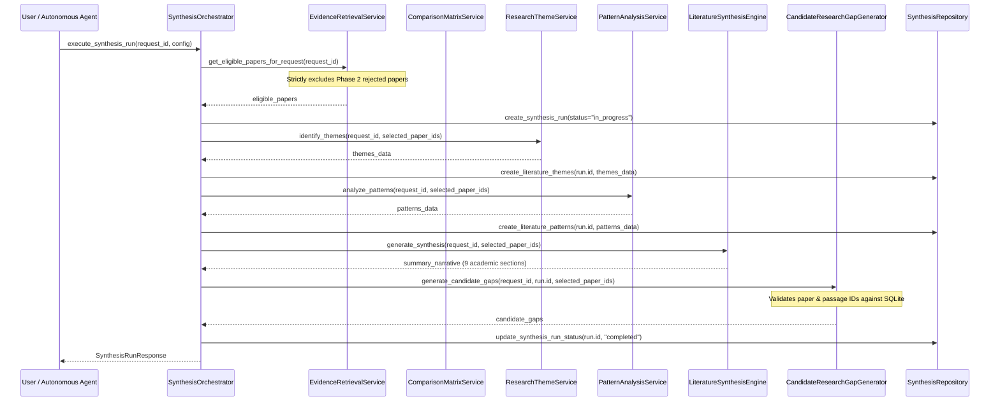

# Literature Synthesis Architecture (Phase 4)

## 1. Architectural Mission

The Literature Synthesis Engine integrates structured representations from Phase 1 (bibliographic metadata), Phase 2 (structured extraction records), and Phase 3 (knowledge graph entities and typed edges) into an academically coherent, multi-perspective literature review.

The primary objective is to move beyond superficial paper summaries and provide **cross-cutting comparative synthesis**:
1. Mapping the methodological landscape across retrieved studies.
2. Characterizing empirical benchmarks, datasets, and performance indicators.
3. Contrasting reported findings, noting consensus and contextual divergence.
4. Synthesizing author-reported limitations and future research agendas.
5. Identifying underexplored intersections in the retrieved literature.
6. Formulating evidence-grounded candidate research gaps.

---

## 2. Component Pipeline

The literature synthesis pipeline operates through a staged, coordinated sequence orchestrated by `SynthesisOrchestrator`:

---

## 3. Narrative Synthesis Structure

The engine generates both structured JSON data and a publication-ready narrative structured into 9 academic sections:

1. **Executive Summary**: Overview of literature collection, time window, and primary paradigms.
2. **Methodological Landscape**: Comparative analysis of algorithmic approaches, model families, and architectures.
3. **Empirical Benchmarks & Datasets**: Benchmark dataset frequencies, domain distributions, and data modality trends.
4. **Evaluation Metrics & Protocols**: Distribution of performance metrics and evaluation rigor across papers.
5. **Reported Findings & Convergent Evidence**: Primary empirical discoveries, consistent outcomes, and areas of high confidence.
6. **Contradictions, Variations & Contextual Divergence**: Divergent findings explained through differing datasets, hyperparameters, or evaluation scopes.
7. **Author-Reported Limitations**: Synthesis of explicit limitations reported by authors (scalability, compute latency, distribution shift).
8. **Future Research Directions**: Author-proposed future work directions mapped across studies.
9. **Synthesis Discussion & Scope Boundaries**: Critical analysis of underexplored areas strictly qualified by retrieved collection coverage.
